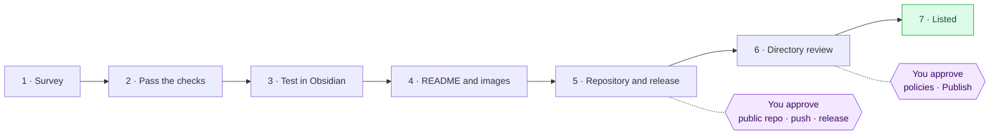

<h1 align="center">Obsidian Plugin Publish</h1>

<p align="center">
  <b>A Claude Code skill that ships Obsidian plugins.</b><br>
  From working code to a polished GitHub release and an approved listing in the Obsidian community directory,<br>
  with your approval at every step that goes public.
</p>

<p align="center">
  <a href="https://github.com/Tuosang/obsidian-plugin-publish-skill/releases/latest"></a>
  
  
  <a href="LICENSE"></a>
</p>

<p align="center"><b>English</b> · <a href="README.zh-CN.md">简体中文</a></p>

---

## Overview

Writing an Obsidian plugin is the fun part. Publishing it well is a dozen chores spread over GitHub, the Obsidian app, CI and a review website, and every one of them has a catch: screenshots that leak your private notes, a release that the directory can't reproduce, a CSS rule the scanner flags, an OAuth button that won't enable in a background tab.

**Obsidian Plugin Publish** is an [Agent Skill](https://docs.claude.com/en/docs/agents-and-tools/agent-skills/overview) for [Claude Code](https://claude.com/claude-code) that knows all of those chores and their catches. Ask Claude to publish your plugin and it works through a fixed, seven-phase pipeline: it audits the code against the directory's rules, tests the plugin inside Obsidian, writes a bilingual README with real screenshots and a demo GIF taken from a throwaway demo vault, sets up attested releases, submits the plugin to the community directory, and fixes the automated review until every check passes.

You stay in charge of everything that is public or personal. Claude prepares each step, tells you exactly what will happen, and waits for your yes.

## The pipeline



| Phase | What Claude does | What stays with you |
| --- | --- | --- |
| **1. Survey** | Reads the manifest, build and git state; checks the plugin id, the GitHub account and similar plugins in the directory | Clarify the plugin's story if it isn't obvious |
| **2. Pass the checks** | Runs Obsidian's official ESLint rules, removes `!important` and hard-coded styling, fixes the manifest, sets `minAppVersion` to the version actually tested, makes the build reproducible | — |
| **3. Test in Obsidian** | Builds into a vault, drives the real app through the `obsidian` CLI, checks light and dark themes and the mobile layout | — |
| **4. README and images** | Writes `README.md` and `README.zh-CN.md`, captures every screenshot and the demo GIF from a demo vault with made-up content, adds a changelog and issue templates | Review the README |
| **5. Repository and release** | Scans everything for personal data, sets up a tag-driven release workflow with build-provenance attestations, verifies the release assets byte for byte | Approve the public repo, the commit email, the first push and each release |
| **6. Directory submission** | Fills in the submission form in your browser, reads the automated review, fixes every finding, cuts a new release and queues a rescan | Sign in, authorise GitHub, accept the Developer Policies, approve **Publish** |
| **7. Listed** | Checks the public listing, records the release process, drafts announcement posts | Decide whether to post them |

## What you get

- **A storefront README** in English and Chinese: badges, a demo GIF, a before/after comparison, one image per feature, install, usage and settings tables, compatibility, known limitations, privacy, how it works, development notes.
- **Honest images** captured from the real app, in light and dark themes and the mobile layout, without a single line of your own notes in them.
- **A clean repository**: MIT licence, changelog, bilingual issue templates, `versions.json`, a version-bump script, and a privacy-scanned commit history with an optional GitHub no-reply address.
- **Reproducible, attested releases**: tests, lint and build in CI, `main.js`, `manifest.json` and `styles.css` attached to a draft release with [build-provenance attestations](https://docs.github.com/en/actions/security-for-github-actions/using-artifact-attestations).
- **A listing in the Obsidian community directory** that passes the automated review: installable from *Settings → Community plugins* inside Obsidian.

## Proven on a real plugin

The skill was distilled from publishing **[Sticky Folders](https://github.com/Tuosang/obsidian-sticky-folders)**, a plugin that pins parent folders at the top of the file explorer. It went from working code to an approved listing in a single session.

<table>
  <tr>
    <th width="50%">The README it produced</th>
    <th width="50%">The demo GIF, from a demo vault</th>
  </tr>
  <tr>
    <td></td>
    <td align="center"></td>
  </tr>
</table>

<p></p>

The directory's automated review, as the skill drove it:

| Check | First submission (0.1.1) | After the skill's fixes (0.1.2) |
| --- | --- | --- |
| Build verification | Pass: release `main.js` reproduced byte for byte | Pass |
| Code obfuscation | Pass | Pass |
| Dependencies | Pass | Pass |
| Network requests | Pass | Pass |
| CSS lint | Warning: `!important` in two rules | Pass: replaced with specificity and Obsidian's `--cursor` variable |
| Releases | Recommendation: no artifact attestations | Pass: attestations verified for `main.js` and `styles.css` |
| Listing | — | Published · Health *Excellent* · Review *Passed* |

## Design principles

**Nothing private goes public.** A real vault holds people's names, meetings and work. Every screenshot and GIF comes from a throwaway demo vault built from a JSON spec of made-up notes, and a privacy scan checks every file git would publish (including image metadata) and the commit emails before the first push and before each release.

**You approve every outward step.** Creating the public repository, the first push, publishing a release, accepting the directory's policies and pressing *Publish* each wait for an explicit yes. Sign-ins, OAuth approvals, passwords and API keys are never entered by Claude.

**Verify, don't assume.** Release assets are compared byte for byte with the local build, attestations are verified, review results are read section by section, and the plugin is exercised inside Obsidian rather than trusted from unit tests alone.

**Leave Obsidian as you found it.** Demo vaults are removed from Obsidian's vault list afterwards, and temporary language or mobile-emulation switches, which share storage with your real vault, are reverted and checked.

## Requirements

| Requirement | Used for |
| --- | --- |
| [Claude Code](https://claude.com/claude-code) with shell access, on macOS or Linux | Running the skill |
| `git` and the [GitHub CLI](https://cli.github.com) (`gh`) | Repository, releases, attestation checks |
| Node.js and npm | Building, testing and linting the plugin |
| Python 3 with Pillow, and `ffmpeg` | Screenshots, cursor overlays, the demo GIF |
| Obsidian desktop with its `obsidian` command-line tool | Driving the real app for tests and captures |
| An Obsidian account and a GitHub account | Signing in to the community directory |
| Claude in Chrome (optional) | Filling in the directory submission in your browser |

## Installation

**Option A · Claude Code plugin** (recommended, updates with `/plugin update`)

```text
/plugin marketplace add Tuosang/obsidian-plugin-publish-skill
/plugin install obsidian-plugin-publish@obsidian-plugin-publish-skill
```

**Option B · Personal skill folder**

```bash
git clone https://github.com/Tuosang/obsidian-plugin-publish-skill.git
ln -s "$PWD/obsidian-plugin-publish-skill/skills/obsidian-plugin-publish" ~/.claude/skills/obsidian-plugin-publish
```

**Option C · Claude.ai**

Download `obsidian-plugin-publish.skill` from the [latest release](https://github.com/Tuosang/obsidian-plugin-publish-skill/releases/latest) and upload it in Claude.ai's skill settings. The phases that drive Obsidian and GitHub from a shell need Claude Code; on Claude.ai the skill is most useful for the README, the review findings and the release checklist.

## Usage

Open Claude Code in your plugin's repository and describe what you want. The skill triggers on its own; you don't need to name it.

```text
Publish this plugin to GitHub and the Obsidian community directory.
Our README has no screenshots. Make it look like a real project, with a demo GIF.
The directory review flagged two warnings. Fix them and rescan.
Ship 0.2.0: changelog, release and directory rescan.
```

```text
把这个插件上架到 Obsidian 社区插件市场。
README 太简陋了，帮我配上截图和动图。
社区审核报了警告，帮我修好重新审核。
```

The skill picks up wherever your plugin already is. A plugin that already has a repository and releases goes straight to the checks, the images or the submission.

## What's inside

```text
obsidian-plugin-publish-skill/
├── .claude-plugin/              Claude Code plugin and marketplace manifests
├── skills/obsidian-plugin-publish/
│   ├── SKILL.md                 The pipeline, ground rules and approval gates
│   ├── references/
│   │   ├── readme.md            README structure, badges, image list, wording
│   │   ├── screenshots.md       Demo vault, Obsidian CLI, CDP captures, settings window, mobile, GIF, cleanup
│   │   └── directory-review.md  Submission walkthrough, review sections, every finding seen and its fix
│   ├── scripts/                 Helpers the skill runs (below)
│   └── assets/                  Release workflow, ESLint config, version bump, example demo vault
├── tools/                       Repository checks and .skill packaging
└── docs/images/                 README images
```

| Script | What it does |
| --- | --- |
| `obsidian_eval.sh` | Runs a file of JavaScript in an Obsidian vault window with a bounded wait, because the CLI can hang while a window reloads |
| `capture.py` | Screenshots a region of a vault window through the DevTools protocol, which renders fresh frames even when the window is covered, and can draw a cursor |
| `make_gif.py` | Turns captured frames with per-frame durations into a small looping GIF |
| `make_demo_vault.py` | Builds a demo vault from a JSON spec and installs the plugin build into it |
| `privacy_scan.py` | Scans everything git would publish, including image bytes, for home paths, personal emails and your own terms, and lists commit emails |

## Limitations

- Built and proven on macOS with Obsidian 1.13 and Claude Code. Linux should work; Windows is untested.
- The submission flow reflects the community directory as of October 2026, which replaced the old pull-request process. If the site changes, `references/directory-review.md` says where to read the current docs.
- The skill covers plugins. Themes go through a similar but separate submission.
- The skill drives your browser and your Obsidian app. Steps that need your identity or consent remain manual by design.

## Contributing

The most valuable contribution is a new review finding: when the community directory flags something the skill doesn't know yet, open an issue with the *Directory review finding* template, or add a row to `references/directory-review.md` with the fix that worked. Bug reports and ideas are welcome in [issues](https://github.com/Tuosang/obsidian-plugin-publish-skill/issues), in English or Chinese.

## Changelog

See [CHANGELOG.md](CHANGELOG.md).

## Acknowledgements

Obsidian's [developer documentation](https://docs.obsidian.md) and [ESLint plugin](https://github.com/obsidianmd/eslint-plugin), the [BRAT](https://github.com/TfTHacker/obsidian42-brat) beta-testing plugin, and Anthropic's [Agent Skills](https://docs.claude.com/en/docs/agents-and-tools/agent-skills/overview) format.

## License

[MIT](LICENSE) © 2026 Kevin Yan
