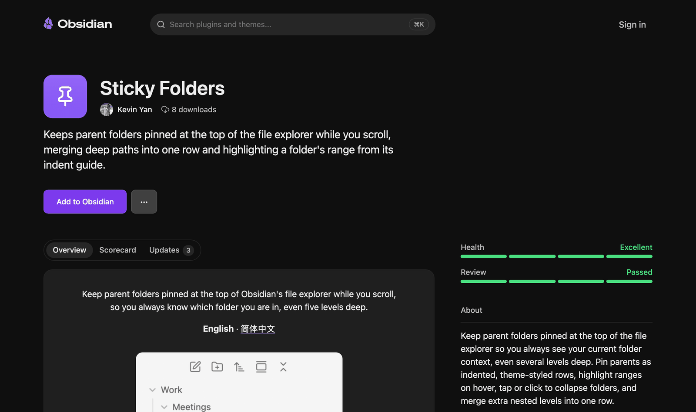
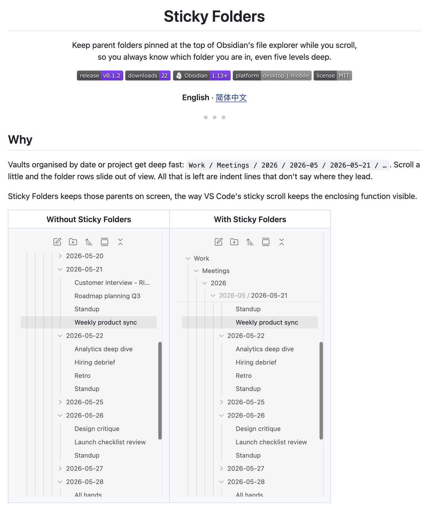

<h1 align="center">Obsidian Plugin Publish</h1>

<p align="center">
  <b>一个帮你发布 Obsidian 插件的 Claude Code skill。</b><br>
  从能跑的代码，到像样的 GitHub 发布，再到通过审核、上架 Obsidian 社区插件市场；<br>
  每一步对外公开的操作，都先经过你的确认。
</p>

<p align="center">
  <a href="https://github.com/Tuosang/obsidian-plugin-publish-skill/releases/latest"></a>
  
  
  <a href="LICENSE"></a>
</p>

<p align="center"><a href="README.md">English</a> · <b>简体中文</b></p>

---

## 概述

写 Obsidian 插件是有意思的部分；把它像样地发布出去，却是散落在 GitHub、Obsidian、CI 和审核网站之间的一大串杂事，而且每一件都有坑：截图泄露了自己的私人笔记，发布的文件官方复现不出来，某条 CSS 被审核标黄，GitHub 授权按钮在后台标签页里一直点不了……

**Obsidian Plugin Publish** 是一个运行在 [Claude Code](https://claude.com/claude-code) 里的 [Agent Skill](https://docs.claude.com/en/docs/agents-and-tools/agent-skills/overview)，它熟悉这些杂事和其中的坑。你让 Claude 发布插件，它就按固定的七个阶段推进：对照官方规则检查代码，在 Obsidian 里实际测试，用一个只装假数据的示例库截图、录动图并写好中英文 README，配置可验证来源的自动发布，提交到社区插件市场，再根据自动审核结果逐条修复，直到全部通过。

凡是公开的、或以你名义进行的操作，决定权都在你手里：Claude 先把每一步准备好，说清楚会发生什么，等你点头再执行。

## 工作流程


<sub>紫色步骤会先等你明确同意，之后才会公开任何内容或以你的名义操作。</sub>

| 阶段 | Claude 做什么 | 由你决定或操作 |
| --- | --- | --- |
| **1. 摸底** | 读插件信息、构建配置和 git 状态，查插件 ID 是否被占用、GitHub 账号、市场里有没有同类插件 | 插件定位不清楚时给一句说明 |
| **2. 通过官方检查** | 用 Obsidian 官方 ESLint 规则检查并修复，去掉 `!important` 和写死的样式，整理插件信息，最低版本号填实际测过的版本，确保构建可以复现 | — |
| **3. 在 Obsidian 里实测** | 构建进库里，通过 `obsidian` 命令行驱动真实的 Obsidian，检查浅色、深色主题和手机布局 | — |
| **4. README 与配图** | 写 `README.md` 和 `README.zh-CN.md`，所有截图和动图都从假数据的示例库里截取，补上更新日志和问题反馈模板 | 审阅 README |
| **5. 仓库与发布** | 扫描所有将要公开的内容有没有个人信息，配置按标签自动打包、带构建来源证明的发布流程，逐字节核对发布文件 | 确认建公开仓库、提交邮箱、首次推送和每次发布 |
| **6. 社区审核** | 在你的浏览器里填写提交表单，读取自动审核结果，逐条修复，发新版本并重新排队审核 | 登录、授权 GitHub、同意开发者政策、确认 **Publish** |
| **7. 上架** | 检查公开页面，记录发版流程，起草推广帖 | 决定发不发帖 |

## 你会得到什么

- **一份像店面一样的 README**，中英文各一份：徽章、演示动图、开启前后对比、每个功能一张图、安装 / 使用 / 设置表格、兼容性、已知限制、隐私说明、实现原理、开发说明。
- **真实而干净的配图**：从真实的 Obsidian 里截取，覆盖浅色、深色主题和手机布局，里面没有一行你自己的笔记。
- **一个规范的仓库**：MIT 许可证、更新日志、中英双语的问题反馈模板、`versions.json`、版本号同步脚本，提交记录经过隐私扫描，可以使用 GitHub 隐私邮箱。
- **可复现、可验证的发布**：CI 里跑测试、代码检查和构建，`main.js`、`manifest.json`、`styles.css` 附在草稿 Release 上，并带有 [构建来源证明](https://docs.github.com/en/actions/security-for-github-actions/using-artifact-attestations)。
- **一个通过自动审核的社区市场条目**：别人在 Obsidian 的「设置 → 第三方插件」里就能直接搜到并安装。

## 真实案例

这个 skill 提炼自 **[Sticky Folders](https://github.com/Tuosang/obsidian-sticky-folders)** 的发布过程。这是一个把上级文件夹钉在文件列表顶部的插件，从能跑的代码到通过审核、上架，只用了一次对话。

<p align="center"><br><sub>Obsidian 社区插件市场上的正式页面：健康度 <i>Excellent</i>，审核 <i>Passed</i>。</sub></p>

<table>
  <tr>
    <th width="62%">它写出的 README</th>
    <th width="38%">它从示例库录制的演示动图</th>
  </tr>
  <tr>
    <td></td>
    <td align="center"></td>
  </tr>
</table>

社区市场自动审核的结果：

| 检查项 | 首次提交（0.1.1） | skill 修复后（0.1.2） |
| --- | --- | --- |
| 构建验证 | 通过：官方重新构建出的 `main.js` 与发布的逐字节一致 | 通过 |
| 代码混淆 | 通过 | 通过 |
| 依赖安全 | 通过 | 通过 |
| 网络请求 | 通过 | 通过 |
| CSS 检查 | 警告：两条规则用了 `!important` | 通过：改用选择器优先级和 Obsidian 的 `--cursor` 变量 |
| 发布文件 | 建议：缺少构建来源证明 | 通过：`main.js` 和 `styles.css` 的来源证明均已验证 |
| 上架状态 | — | 已上架 · 健康度 *Excellent* · 审核 *Passed* |

## 设计原则

**私人内容绝不公开。** 真实的笔记库里有人名、会议和工作内容。所有截图和动图都来自一个用 JSON 描述生成的假数据示例库。首次推送前和每次发布前，隐私扫描会检查 git 将要公开的每一个文件（包括图片元数据）以及提交邮箱。

**每一步对外操作都由你确认。** 建公开仓库、首次推送、发布 Release、同意社区市场的政策、点 *Publish*，每一步都要等你明确同意。登录、OAuth 授权、密码和 API 密钥，Claude 一律不代填。

**只信核实过的结果。** 发布文件和本地构建逐字节比对，来源证明逐个验证，审核结果逐节阅读，插件在 Obsidian 里真实运行，而不是只看单元测试。

**用完把 Obsidian 恢复原样。** 示例库用完会从 Obsidian 的库列表里移除；临时切换的界面语言和手机模拟会和你的真实库共享存储，用完会切回来并核实。

## 运行要求

| 依赖 | 用途 |
| --- | --- |
| [Claude Code](https://claude.com/claude-code)（可以运行命令行），macOS 或 Linux | 运行这个 skill |
| `git` 和 [GitHub CLI](https://cli.github.com)（`gh`） | 仓库、发布、来源证明验证 |
| Node.js 和 npm | 构建、测试、检查插件代码 |
| Python 3（含 Pillow）和 `ffmpeg` | 截图、画鼠标指针、合成动图 |
| Obsidian 桌面版及其 `obsidian` 命令行工具 | 驱动真实的 Obsidian 做测试和截图 |
| Obsidian 账号和 GitHub 账号 | 登录社区插件市场 |
| Claude in Chrome（可选） | 在你的浏览器里填写提交表单 |

## 安装

**方式一 · Claude Code 插件**（推荐，可用 `/plugin update` 更新）

```text
/plugin marketplace add Tuosang/obsidian-plugin-publish-skill
/plugin install obsidian-plugin-publish@obsidian-plugin-publish-skill
```

**方式二 · 个人 skill 文件夹**

```bash
git clone https://github.com/Tuosang/obsidian-plugin-publish-skill.git
ln -s "$PWD/obsidian-plugin-publish-skill/skills/obsidian-plugin-publish" ~/.claude/skills/obsidian-plugin-publish
```

**方式三 · Claude.ai 网页版**

从[最新版本](https://github.com/Tuosang/obsidian-plugin-publish-skill/releases/latest)下载 `obsidian-plugin-publish.skill`，在 Claude.ai 的 Skills 设置里上传。需要在命令行里驱动 Obsidian 和 GitHub 的阶段只能在 Claude Code 里完成；网页版里它最适合用来写 README、解读审核结果和核对发布清单。

## 使用

在插件仓库里打开 Claude Code，直接说你想做什么就行。skill 会自动启用，不需要点名。

```text
把这个插件上架到 Obsidian 社区插件市场。
README 太简陋了，帮我配上截图和动图，做得像个正规项目。
社区审核报了两个警告，帮我修好重新审核。
发 0.2.0：更新日志、Release，再让市场重新审核。
```

```text
Publish this plugin to GitHub and the Obsidian community directory.
The directory review flagged two warnings. Fix them and rescan.
```

不管插件现在处于哪一步，skill 都会接着往下做：已经有仓库和 Release 的插件，会直接进入检查、配图或提交环节。

## 仓库结构

```text
obsidian-plugin-publish-skill/
├── .claude-plugin/              Claude Code 插件与插件市场清单
├── skills/obsidian-plugin-publish/
│   ├── SKILL.md                 工作流程、基本原则和确认节点
│   ├── references/
│   │   ├── readme.md            README 结构、徽章、配图清单、措辞
│   │   ├── screenshots.md       示例库、Obsidian 命令行、截图、设置窗口、手机布局、动图、收尾
│   │   └── directory-review.md  提交流程、审核项、遇到过的每条审核意见和修法
│   ├── scripts/                 skill 运行时使用的脚本（见下表）
│   └── assets/                  发布流程、ESLint 配置、版本号脚本、示例库模板
├── tools/                       仓库自检与 .skill 打包
└── docs/images/                 README 配图
```

| 脚本 | 作用 |
| --- | --- |
| `obsidian_eval.sh` | 在指定的 Obsidian 库窗口里执行一段 JavaScript，带超时；窗口重载时命令行可能卡住 |
| `capture.py` | 通过 DevTools 协议截取库窗口的某一块区域，窗口被挡住也能拿到最新画面，可以画上鼠标指针 |
| `make_gif.py` | 把截好的帧按各自时长合成为体积小、循环播放的动图 |
| `make_demo_vault.py` | 根据 JSON 描述生成示例库，并把插件构建装进去 |
| `privacy_scan.py` | 扫描 git 将要公开的所有文件（含图片字节），查找本机路径、个人邮箱和你指定的关键词，并列出提交邮箱 |

## 局限

- 在 macOS、Obsidian 1.13 和 Claude Code 上开发并验证。Linux 应该可用，Windows 未测试。
- 提交流程基于 2026 年 10 月的社区插件市场，它取代了以前提 PR 的方式。如果网站有变化，`references/directory-review.md` 写明了去哪里看最新文档。
- 目前只覆盖插件，主题的提交流程类似但不相同。
- skill 会操作你的浏览器和 Obsidian；需要你身份或同意的步骤，按设计始终由你手动完成。

## 参与贡献

最有价值的贡献是新的审核意见：当社区市场报出 skill 还不认识的问题时，请用 *Directory review finding* 模板提 issue，或者在 `references/directory-review.md` 里补一行，写明有效的修法。问题和建议欢迎在 [issues](https://github.com/Tuosang/obsidian-plugin-publish-skill/issues) 里提，中英文都可以。

## 更新日志

见 [CHANGELOG.md](CHANGELOG.md)。

## 致谢

Obsidian 的[开发者文档](https://docs.obsidian.md)和 [ESLint 插件](https://github.com/obsidianmd/eslint-plugin)、[BRAT](https://github.com/TfTHacker/obsidian42-brat) 测试版插件管理器，以及 Anthropic 的 [Agent Skills](https://docs.claude.com/en/docs/agents-and-tools/agent-skills/overview) 格式。

## 许可证

[MIT](LICENSE) © 2026 Kevin Yan
